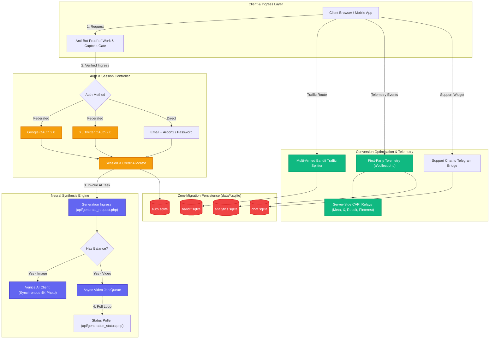
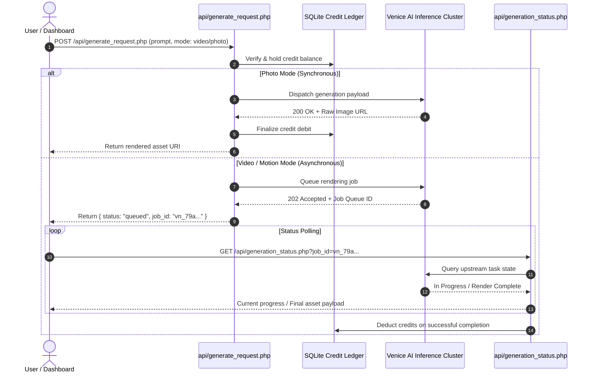

<p align="center">
  
</p>

<p align="center">
  <a href="#-architecture-topology"></a>
  <a href="#-tech-stack"></a>
  <a href="#-data-persistence-philosophy"></a>
  <a href="#-neural-synthesis-matrix"></a>
  <a href="#-multi-armed-bandit-conversion-engine"></a>
  <a href="#-omnichannel-capi-telemetry"></a>
</p>

---

## ⚡ Executive Summary

**SynapseForge** is an enterprise-grade, high-throughput autonomous backend engine purpose-built for generative AI media platforms and conversion-optimized web applications. 

Unlike traditional monolithic frameworks that introduce bloat and heavy ORM overhead, SynapseForge operates on a **zero-dependency, asynchronous execution architecture**. It unifies state-of-the-art multi-modal neural generation (synchronous 4K diffusion and asynchronous prompt-to-video / img2vid polling queues) with an algorithmic multi-armed bandit traffic distributor, direct server-side Conversion APIs (CAPI), privacy-preserving zero-cookie analytics, and an autonomous zero-migration SQLite data fabric.

```
       [ Client / Browser / Mobile App ]
                       │
                       ▼
 ╔═════════════════════════════════════════════════════════════════════════╗
 ║                         SYNAPSEFORGE CORE                               ║
 ║                                                                         ║
 ║  ┌───────────────────────────────────────────────────────────────────┐  ║
 ║  │                   Ingress & Anti-Bot Defense                      │  ║
 ║  │      • Invisible Proof-of-Work (nv_pow)    • hCaptcha Shield      │  ║
 ║  └─────────────────────────────────┬─────────────────────────────────┘  ║
 ║                                    │                                    ║
 ║  ┌─────────────────────────────────┴─────────────────────────────────┐  ║
 ║  │               Identity, Auth & Micro-Credits Matrix               │  ║
 ║  │   • Google OAuth 2.0   • X (Twitter) PKCE   • Session Tokens      │  ║
 ║  │   • Device Fingerprint • Resend Email Codes • Credit Deductions   │  ║
 ║  └───────────┬─────────────────────┬─────────────────────┬───────────┘  ║
 ║              │                     │                     │              ║
 ║              ▼                     ▼                     ▼              ║
 ║   ┌─────────────────────┐┌───────────────────┐┌─────────────────────┐   ║
 ║   │   Neural Engine     ││   Bandit Router   ││ Telemetry & CAPI    │   ║
 ║   │ • Synchronous Photo ││ • 13+ LP Variants ││ • Salted IP Tracker │   ║
 ║   │ • Async Video Queue ││ • Dynamic Weights ││ • Meta/X/Reddit CAPI│   ║
 ║   │ • Venice AI Client  ││ • Real-time Splits││ • Telegram Helpdesk │   ║
 ║   └──────────┬──────────┘└─────────┬─────────┘└──────────┬──────────┘   ║
 ║              │                     │                     │              ║
 ║              └─────────────────────┼─────────────────────┘              ║
 ║                                    ▼                                    ║
 ║  ┌───────────────────────────────────────────────────────────────────┐  ║
 ║  │                 Autonomous SQLite Micro-Stores                    │  ║
 ║  │   • Self-provisioning schemas on first hit (CREATE IF NOT EXISTS) │  ║
 ║  └───────────────────────────────────────────────────────────────────┘  ║
 ╚═════════════════════════════════════════════════════════════════════════╝
```

---

## 🏛️ Architecture Topology

### High-Level System Workflow



---

## 🔬 Core Subsystems Deep Dive

### 1. 🧠 Multi-Modal Neural Synthesis Matrix (`api/`, `venice_client.php`)
- **Dual Pipeline Inference:**
  - **Synchronous Photorealistic Diffusion:** Sub-second generation and response delivery for text-to-image requests via external Venice AI inference models.
  - **Asynchronous Prompt-to-Video & Img2Vid Queue:** High-complexity video synthesis tasks are scheduled asynchronously into a polling queue. Clients receive immediate job tokens and poll `api/generation_status.php` with progressive exponential backoff until render completion.
- **Fail-Safe Credit Accounting:** Credits are held in escrow during generation and only deducted upon guaranteed stream/file return.



### 2. ⚖️ Multi-Armed Bandit Dynamic Traffic Router (`lp/lp_ab.php`, `api/bandit.php`)
- **Autonomous Variant Routing:** Intelligently balances traffic allocation across up to 13 landing page variants (`v1`–`v13`) based on real-time server-side conversion feedback.
- **Dynamic Weight Adaptation:** Uses Bayesian conversion tracking logged in `split_weight_log` to shift traffic towards winning variants while maintaining exploration across new challenger layouts.
- **Persistent Attribution:** Issues tamper-proof server-side session cookies to guarantee visitor consistency across multi-step funnels.

### 3. 🛡️ Zero-Trust Identity, Authentication & Micro-Credits (`auth/`, `functions/auth_db.php`)
- **Federated & Direct Authentication:**
  - **Google OAuth 2.0:** Secure identity token verification and one-click account creation.
  - **X (Twitter) OAuth 2.0 with PKCE:** Modern OAuth flow for social authentication without client secrets exposed.
  - **Password Auth:** Cryptographically secure password hashing with automated salting.
- **Resend Universal Email Verification:** Purpose-based rate-limited transactional codes (`functions/email_codes.php`) with attempt counters and expiry windows.
- **Device & Fingerprint Binding:** Guards against credential stuffing and session theft by validating IP subnet and user agent signatures.

### 4. 📊 First-Party Privacy-Preserving Telemetry (`a/collect.php`)
- **Cookieless Analytics:** Self-hosted event ingestion pipeline capturing clicks, views, scroll depths, and conversion milestones.
- **GDPR-Compliant Salted Hashing:** User IP addresses are immediately hashed using a secret rotating salt (`LXTRACK_IP_SALT`) before persistence—zero raw IP addresses or personally identifiable network telemetry is ever stored.
- **Real-Time Country & Geo Lookups:** Resolves geographical distributions through local lightweight IP range lookups.

### 5. 📡 Omnichannel Server-Side Conversion API (CAPI) (`functions/*_capi.php`)
- **Bypasses Ad-Blockers & Safari ITP:** Client-side tracking pixels are prone to 40%+ signal loss. SynapseForge routes conversion events server-to-server:
  - **Meta Conversions API (CAPI)**
  - **X (Twitter) CAPI**
  - **Reddit CAPI**
  - **Pinterest CAPI**
- **Deduplication Engine:** Synchronizes client-side event IDs with server-side payload hashes to prevent double counting.

### 6. 💬 Telegram Bridge Support Gateway (`chat/`, `functions/support_lib.php`)
- **Bi-Directional Helpdesk:** Visitor messages submitted to the front-end chat widget are instantly pushed to a dedicated Telegram admin chat via Telegram Bot webhook APIs.
- **Agent Replies Delivered to Web:** Admin responses typed inside Telegram are automatically polled back and rendered in the visitor's browser in real-time.

### 7. 📦 Desktop Binary Distribution Gateway (`api/desktop_download.php`, `api/dl_track.php`)
- **OS-Aware Download Routing:** Auto-detects client architecture (Windows x64 / macOS Apple Silicon / macOS Intel) and provides signed, rate-limited direct download streams with telemetry tracking.

---

## 📁 Repository Anatomy

```text
source/
├── api/                        # REST API Endpoints
│   ├── auth_google.php         # Google OAuth 2.0 token exchange & callback
│   ├── auth_x.php              # X (Twitter) PKCE OAuth integration
│   ├── bandit.php              # Multi-armed bandit split testing controller
│   ├── desktop_download.php    # Signed OS binary download distributor
│   ├── dl_track.php            # Download telemetric tracker
│   ├── generate_request.php    # AI photo/video dispatch endpoint
│   ├── generation_status.php   # Async video generation polling worker
│   ├── nv_notify.php           # Event notification distributor
│   ├── nv_pow.php              # Invisible client proof-of-work challenge
│   └── venice_client.php       # Low-latency Venice AI client wrapper
├── auth/                       # OAuth callback handlers & access controllers
├── auth_callback.php           # Central OAuth redirect orchestrator
├── chat/                       # Live visitor chat widget backend
│   ├── chat_api.php            # Chat polling & message ingestion
│   └── upload_resume.php       # Careers & resume attachment handler
├── data/                       # Storage & Scheduled Jobs
│   ├── desktop_links.json      # Binary distribution metadata targets
│   ├── batch_send.php          # Async campaign email runner
│   ├── send_campaign.php       # Scheduled campaign push worker
│   └── ios_send.php            # Push notification delivery worker
├── functions/                  # Core Business Logic & Helpers
│   ├── auth_db.php             # User model, credentials & session state
│   ├── email_codes.php         # Universal verification code engine
│   ├── welcome_mail.php        # Transactional Resend email dispatcher
│   ├── support_lib.php         # Telegram Bot bi-directional bridge
│   ├── captcha.php             # hCaptcha server-side verification
│   ├── reviews.php             # Product reviews and rating aggregation
│   ├── x_capi.php              # Server-to-server X (Twitter) CAPI
│   └── phone_verify.php        # SMS verification engine
├── lk/                         # Member Dashboard (Личный Кабинет) Engine
│   ├── lk_core.php             # Member session guard & credit status
│   └── lk_dlblock.php          # Dynamic download portal widgets
├── a/                          # Self-Hosted Analytics Engine
│   ├── collect.php             # Salted event collector endpoint
│   └── dashboard.php           # Internal conversion & telemetry dashboard
├── PHPMailer/                  # Vendored SMTP transport library
├── .env.example                # Blueprint for environment variables
├── ENGINE.md                   # Technical subsystem execution specifications
└── LICENSE                     # Proprietary software license
```

---

## 🛠️ API Interface Specifications

| Endpoint | Method | Purpose | Key Parameters |
|:---|:---:|:---|:---|
| `/api/generate_request.php` | `POST` | Dispatches neural generation request | `prompt`, `aspect_ratio`, `mode` (`photo` \| `video`) |
| `/api/generation_status.php` | `GET` | Polls status of async generation job | `job_id`, `token` |
| `/api/bandit.php` | `GET` | Fetches active variant for visitor | `cid`, `lp_version` |
| `/a/collect.php` | `POST` | Ingests privacy-first click/conversion event | `event`, `target`, `variant`, `timestamp` |
| `/api/auth_google.php` | `POST` | Validates Google OAuth credential token | `credential` |
| `/api/auth_x.php` | `GET` | Handles X OAuth callback & code exchange | `code`, `state` |
| `/api/desktop_download.php` | `GET` | Delivers signed OS installation binary | `os` (`win` \| `mac`), `version` |

---

## 💾 Zero-Migration Data Persistence

SynapseForge removes the fragility of database migrations. Every subsystem utilizes an autonomous, isolated SQLite database under `data/`:

* **`data/users.sqlite`** — User credentials, salted password hashes, credit balances, activation codes.
* **`data/bandit.sqlite`** — Variant impressions, click counts, conversion attributions.
* **`data/analytics.sqlite`** — Anonymized click streams, geographical buckets, event timestamps.
* **`data/chat.sqlite`** — Visitor sessions, Telegram message mappings, resolution states.

> **Zero-Setup Schema Ingestion:** Every database module automatically runs `CREATE TABLE IF NOT EXISTS` upon its first connection. Creating a new local or staging environment requires zero SQL seed scripts or database configuration.

---

## 🚀 Quickstart & Development

### Prerequisites
* **PHP 7.4+** or **PHP 8.1+** (CLI or FPM) with `php-curl`, `php-sqlite3`, and `php-json` extensions enabled.
* No Composer or Node.js build steps required.

### 1. Clone & Configure Environment
```bash
# Clone the repository
git clone https://github.com/dk5488/SynapseForge.git
cd SynapseForge

# Instantiate environment variables from template
cp .env.example .env
```

### 2. Configure Key Parameters in `.env`
Edit `.env` with your preferred credentials:
```ini
# Venice AI Inference Engine
VENICE_API_KEY=your_venice_api_key

# Privacy Telemetry Salt
LXTRACK_IP_SALT=c8f2b3149e0a78619bc...

# Telegram Bridge
TG_BOT_TOKEN=123456789:ABCdefGhIJKlmNoPQRsTUVwxyZ
TG_CHAT_ID=-100123456789

# Resend Transactional Mail
RESEND_API_KEY=re_123456789...
```

### 3. Launch Development Server
```bash
php -S 127.0.0.1:8000
```
Visit `http://127.0.0.1:8000/api/bandit.php` in your browser to verify that the SQLite databases initialize automatically under `data/`.

---

## 🔒 Security & Data Governance

1. **Strict Secrets Redaction:** Credentials and API keys are read exclusively from environment variables (`$_ENV` or process environment). Hardcoded secret fallbacks have been eliminated.
2. **GDPR/CCPA Compliance:** Raw IP addresses are never saved to disk. All network addresses are hashed with high-entropy cryptographic salt before persistence.
3. **Bot & DDoS Mitigation:** High-value generation and trial endpoints are guarded with invisible proof-of-work challenges (`api/nv_pow.php`) and server-side hCaptcha validation.
4. **Isolated Blast Radius:** Each subsystem writes to its own isolated SQLite database, preventing a failure in analytics from cascading to identity or neural generation.

---

<p align="center">
  <b>SynapseForge</b> • Engineered for high-velocity AI generation and autonomous conversion optimization.
</p>
